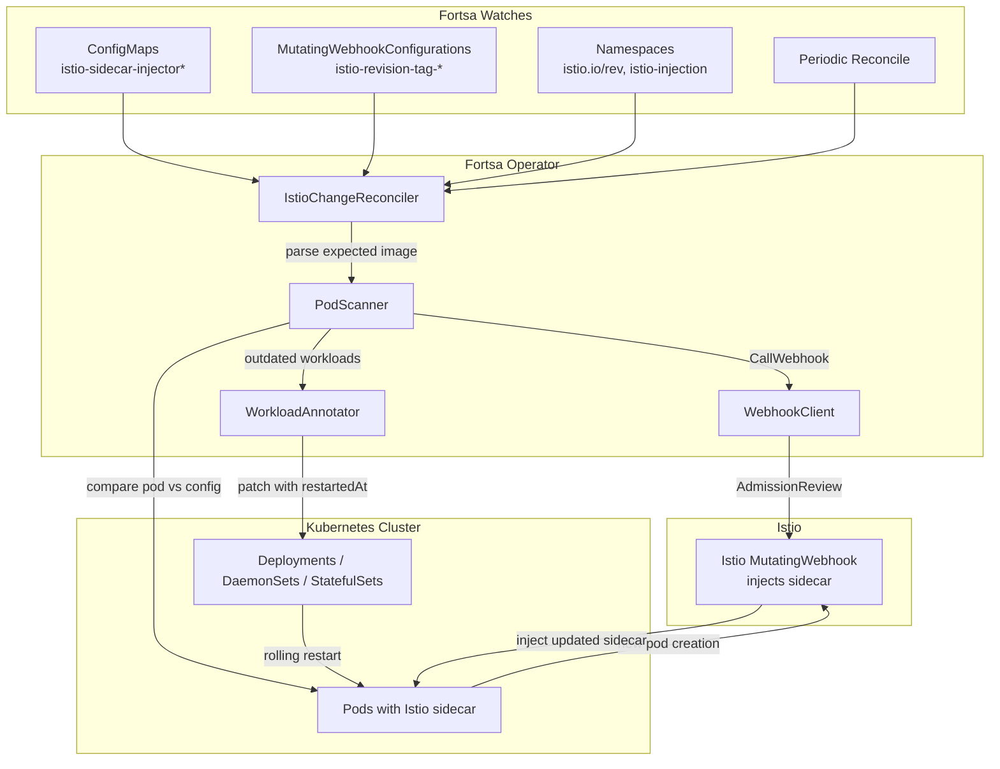
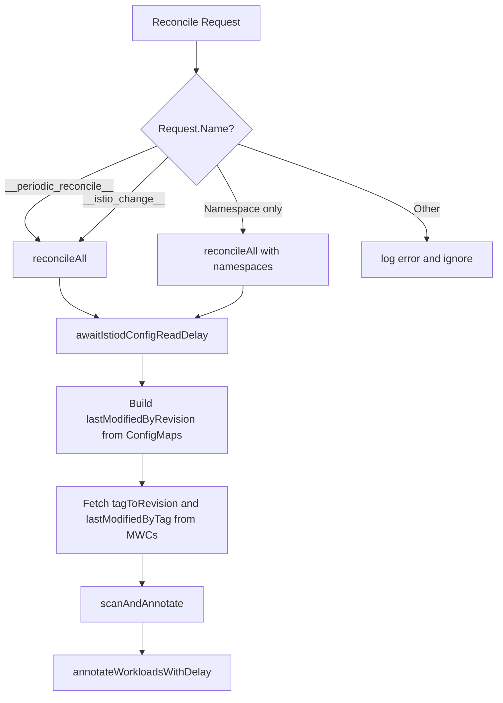
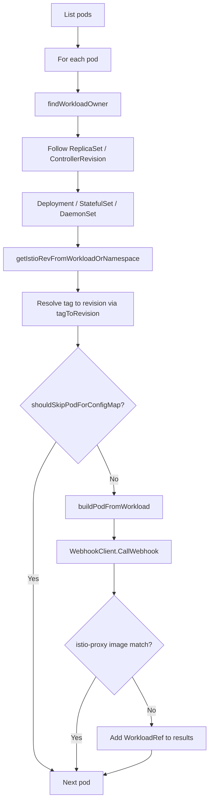

# Fortsa Architecture

This document describes how Fortsa works internally: its components, data flows, and package structure.

## Overview

**Purpose**: Fortsa is a Kubernetes operator that keeps Istio's data-plane up-to-date by automatically restarting workloads with outdated sidecar proxies when Istio configuration changes.

**Design principles**:

- No CRDs; uses only built-in Kubernetes resources
- Minimal dependencies (controller-runtime, k8s.io/client-go)
- Single binary deployed via bare container (FROM scratch)
- No access required outside the cluster

**Key mechanism**: Fortsa adds the `fortsa.scaffidi.net/restartedAt` annotation to Deployments, StatefulSets, and DaemonSets. This triggers a rolling restart of their pods—the same mechanism used by `kubectl rollout restart`. When a pod is recreated, Istio's MutatingWebhook injects the updated sidecar proxy.

Optionally (`--enable-argo-rollouts`, default off), Fortsa also detects and restarts pods owned by Argo Rollouts `Rollout` resources, using Argo's own `spec.restartAt` field instead of the annotation. See [Argo Rollouts Support](#argo-rollouts-support-optional) below.

## Package Structure

```text
fortsa/
├── cmd/main.go              # Entry point, flag parsing, manager setup
├── internal/
│   ├── constants/           # Shared constants (istio-system, prefixes, labels, annotation key)
│   ├── controller/          # IstioChangeReconciler, reconcile routing
│   ├── mwc/                 # MWC predicate, tag mapping fetch, reconcile request
│   ├── namespace/           # Namespace predicates, reconcile request
│   ├── periodic/            # Periodic reconcile source, reconcile request
│   ├── podscanner/           # Pod scanning, outdated sidecar detection
│   ├── annotator/           # Workload annotation for restarts
│   ├── configmap/           # ConfigMap predicate, reconcile request, parser, fetch (BuildLastModifiedByRevision)
│   ├── rollout/              # Argo Rollouts Rollout helpers (unstructured; optional, no CRD import)
│   └── webhook/             # Istio injection webhook client
├── config/                  # Kustomize manifests (RBAC, manager, Prometheus)
├── helm/src/chart/          # Helm chart for deployment
└── test/                    # E2E and integration tests
```

**Package dependency graph**:

```text
main       → controller
controller → annotator, configmap, mwc, namespace, periodic, podscanner
annotator  → rollout, (k8s client)
configmap  → (k8s client)
mwc        → (k8s client)
namespace  → (controller-runtime)
periodic   → (controller-runtime)
podscanner → rollout, webhook
rollout    → (k8s client, unstructured)
webhook    → (k8s client)
```

The `configmap` package provides the ConfigMap trigger (Filter, ReconcileRequest, ReconcileRequestName), parser (ParseConfigMapValues, GetConfigMapLastModified), and fetch (BuildLastModifiedByRevision). BuildLastModifiedByRevision lists istio-sidecar-injector ConfigMaps, parses each, and returns revision -> LastModified; no cache, built fresh on each reconcile. The `mwc` package provides the MWC trigger (Filter, ReconcileRequest) and tag mapping fetch (FetchTagToRevisionAndLastModified). ConfigMap and MWC both use the same reconcile request name (`__istio_change__`) so controller-runtime deduplicates their events.

## Component Architecture



## Startup Flow

The application starts in [cmd/main.go](cmd/main.go) with the following sequence:

1. **Parse flags**: `--dry-run`, `--compare-hub`, `--restart-delay`, `--istiod-config-read-delay`, `--reconcile-period`, `--annotation-cooldown`, `--skip-namespaces`, TLS paths for webhook and metrics
2. **Register scheme**: `clientgoscheme` and `corev1` for Kubernetes API types
3. **Create Manager**: controller-runtime Manager with leader election (`71f32f9d.fortsa.scaffidi.net`), metrics on `:8080`, health probes on `:8081`
4. **Instantiate reconciler**: `controller.NewIstioChangeReconciler` (which creates `PodScanner` and `WorkloadAnnotator` internally; `PodScanner` constructs the Istio webhook client)
5. **Register controller**: `controller.SetupIstioChangeController` registers watches for ConfigMap (with predicate), MutatingWebhookConfiguration (with predicate), Namespace (with predicate), and optional periodic source. No primary `For` resource.
6. **Add health checks**: `healthz.Ping` for healthz and readyz
7. **Start manager**: `mgr.Start(ctrl.SetupSignalHandler())`

## Reconcile Flow

The `Reconcile` method in [internal/controller/istio_change_reconciler.go](internal/controller/istio_change_reconciler.go) routes requests by type:



**Request types**:

| Request | Trigger | Handler |
| ------- | ------- | ------- |
| `__periodic_reconcile__` | Periodic ticker | `reconcileAll()` — await delay, build last-modified from ConfigMaps and MWCs, scan |
| `__istio_change__` | ConfigMap or MWC change | `reconcileAll()` — await delay, build last-modified from ConfigMaps and MWCs, scan |
| Namespace-only (req.Name = namespace, req.Namespace empty) | Namespace label change | `reconcileAll(ctx, []string{namespace})` — scan only that namespace |
| Other | (any) | Log error, ignore, no requeue |

ConfigMap and MWC watches both enqueue the same request name `__istio_change__`. Controller-runtime deduplicates by NamespacedName, so multiple rapid events coalesce into a single reconcile run.

All paths converge on `reconcileAll()`, which awaits the Istiod config read delay, builds last-modified data from ConfigMaps and MWCs, then calls `scanAndAnnotate()` → `annotateWorkloadsWithDelay()`.

## Per-Pod Outdated Detection Flow

The PodScanner in [internal/podscanner/pod_scanner.go](internal/podscanner/pod_scanner.go) determines whether a pod has an outdated Istio sidecar:



**Steps**:

1. **List pods** — Optionally limited by namespace (e.g., for namespace-scoped reconciliation)
2. **findWorkloadOwner** — Follow ownerReferences: Pod → ReplicaSet/ControllerRevision → Deployment/StatefulSet/DaemonSet. When `--enable-argo-rollouts` is set, a ReplicaSet owned directly by a `Rollout` (argoproj.io/v1alpha1) resolves to that Rollout instead (Rollouts own their ReplicaSets directly, not via Deployment)
3. **getIstioRevFromWorkloadOrNamespace** — Get `istio.io/rev` from workload pod template, or from namespace (`istio.io/rev` or `istio-injection=enabled`); returns `"default"` when namespace has `istio-injection=enabled`
4. **Resolve tag → revision** — Use `tagToRevision` map from `istio-revision-tag-*` MWCs
5. **shouldSkipPodForConfigMap** — Skip if pod was created at or after max(ConfigMap lastModified, MWC lastModified) + IstiodConfigReadDelay
6. **buildPodFromWorkload** — Construct a Pod from the workload's pod template
7. **WebhookClient.CallWebhook** — Send AdmissionReview to Istio `/inject`, get mutated pod with expected sidecar
8. **Compare images** — Extract `istio-proxy` image from current pod and from webhook response; compare (optionally including registry via `--compare-hub`)
9. **If mismatch** — Add WorkloadRef to results for annotation

## Webhook Client

[internal/webhook/webhook_client.go](internal/webhook/webhook_client.go) calls the Istio sidecar injection webhook to determine the expected pod shape:

- **URL and caBundle**: Read from `istio-sidecar-injector` or `istio-sidecar-injector-<revision>` MutatingWebhookConfiguration; for default tag, prefers `istio-revision-tag-default` if it exists
- **Request**: Sends `AdmissionReview` with the pod (built from workload template) to the webhook's `/inject` path
- **Response**: Applies the JSON patch from the response to obtain the mutated pod, then extracts the expected `istio-proxy` container image
- **Revisions**: Supports both default revision (`istiod.istio-system.svc`) and revision-specific (`istiod-<revision>.istio-system.svc`)

## ConfigMap Parser

The `configmap` package parses Istio sidecar injector ConfigMaps and builds last-modified data:

- **[configmap_parser.go](internal/configmap/configmap_parser.go)**: `ParseConfigMapValues` extracts `Revision`, `Hub`, `Tag`, `Image` (global.proxy.image) from the values JSON; revision can also come from ConfigMap label `istio.io/rev`. `GetConfigMapLastModified` uses `metadata.managedFields` timestamps when available; falls back to `creationTimestamp`
- **[fetch.go](internal/configmap/fetch.go)**: `BuildLastModifiedByRevision` lists istio-sidecar-injector ConfigMaps in istio-system, parses each via ParseConfigMapValues, returns revision -> LastModified. No cache; invoked by reconciler on each reconcile

## Workload Annotator

[internal/annotator/workload_annotator.go](internal/annotator/workload_annotator.go) triggers rolling restarts:

- **Annotation**: Patches `spec.template.metadata.annotations` with `fortsa.scaffidi.net/restartedAt` (RFC3339 timestamp) via JSON merge patch
- **Cooldown**: When `annotationCooldown` is set, skips re-annotating if the workload was annotated within that duration
- **Supported kinds**: Deployment, StatefulSet, DaemonSet, and (optionally) Rollout — see [Argo Rollouts Support](#argo-rollouts-support-optional)

## Argo Rollouts Support (optional)

Argo Rollouts' `Rollout` resource creates and owns its own ReplicaSets directly — it is not
a Deployment/StatefulSet/DaemonSet, so Fortsa ignores it by default. Passing
`--enable-argo-rollouts` (Helm: `fortsaOptions.argoRollouts.enabled: true`) turns on detection
and restart for Rollout-owned pods. This requires the Rollout CRD (`argoproj.io/v1alpha1`) to be
installed in the cluster and grants additional RBAC (`get`/`list`/`watch`/`patch` on
`rollouts.argoproj.io`) — see [config/rbac/role.yaml](config/rbac/role.yaml) and the Helm chart's
`manager-role.yaml`, both gated behind the same flag/value.

[internal/rollout/rollout.go](internal/rollout/rollout.go) implements this using
`unstructured.Unstructured` via the existing controller-runtime client — **no new Go dependency**
on `argoproj.io/argo-rollouts` is introduced, keeping Fortsa's "minimal dependencies" principle
intact.

- **Pod template resolution**: A `Rollout` can define its pods inline (`spec.template`) or via
  `spec.workloadRef` pointing at a Deployment (iFood's `ifood-app` chart uses the latter). When
  `workloadRef` is used, Argo Rollouts' own controller resolves `spec.template` only in-memory and
  never persists it back to the stored Rollout object — so Fortsa reads the referenced Deployment's
  `spec.template` directly instead of trusting a (necessarily empty) `Rollout.spec.template`.
  `ExtractPodTemplateSpec` implements this: inline template if present and non-empty, otherwise
  fetch the `workloadRef` Deployment (only `kind: Deployment`, `apiVersion: apps/v1` supported).
- **Restart mechanism**: Instead of the `restartedAt` pod-template annotation, Fortsa patches the
  Rollout's own `spec.restartAt` field (RFC3339 timestamp) — the same mechanism used by
  `kubectl argo rollouts restart`. The existing `--annotation-cooldown` logic reads this field back
  for Rollouts the same way it reads the `restartedAt` annotation for the other kinds.
- **Missing CRD is not an error**: If the Rollout CRD isn't installed (or the specific Rollout is
  gone), `rollout.Get` returns `(nil, nil)` rather than an error, so Fortsa fails safely — it skips
  that pod instead of crashing the reconcile loop.

## Kubernetes Resources

| Resource | Usage |
| -------- | ----- |
| ConfigMap | Istio sidecar injector config (`istio-sidecar-injector*`) |
| MutatingWebhookConfiguration | Tag mapping (`istio-revision-tag-*`), webhook URL/caBundle |
| Namespace | Istio labels (`istio.io/rev`, `istio-injection`) |
| Pod | Sidecar image comparison |
| Deployment / StatefulSet / DaemonSet | Patched with restartedAt annotation |
| ReplicaSet / ControllerRevision | Owner chain traversal |
| Rollout (argoproj.io/v1alpha1, optional) | Patched with `spec.restartAt`; requires `--enable-argo-rollouts` |

## Configuration Flags

| Flag | Default | Description |
| ---- | ------- | ----------- |
| `--dry-run` | false | Log what would be done without annotating workloads |
| `--compare-hub` | false | Require container image registry to match ConfigMap hub when detecting outdated pods |
| `--restart-delay` | 0 | Delay between restarting each workload (e.g., 5s) |
| `--istiod-config-read-delay` | 10s | Wait for Istiod to read updated ConfigMap before scanning |
| `--reconcile-period` | 0 | Period between full reconciliations; 0 disables periodic reconcile |
| `--annotation-cooldown` | 5m | Skip re-annotating if workload was annotated within this duration |
| `--skip-namespaces` | kube-system,istio-system | Comma-separated namespaces to skip when scanning pods |
| `--enable-argo-rollouts` | false | Detect and restart Argo Rollouts `Rollout` resources (requires the Rollout CRD and RBAC for `rollouts.argoproj.io`) |

## lastModifiedByRevision and Pod Skip Logic

The reconciler builds `lastModifiedByRevision` (revision -> ConfigMap LastModified) from the current istio-sidecar-injector ConfigMaps and passes it to the pod scanner for skip logic. Pods created after config change + IstiodConfigReadDelay are skipped (they may already have the correct sidecar).

- **reconcileAll**: First awaits IstiodConfigReadDelay (so Istiod can read updated config). Then calls `configmap.BuildLastModifiedByRevision` to build the map from the current ConfigMap list. No cache; the map is built fresh on each reconcile. When limitToNamespaces is nil, scans all namespaces; when non-nil, restricts to those namespaces.

Deduplication comes from the shared request name `__istio_change__`: multiple ConfigMap and MWC watch events coalesce into one reconcile before the workqueue processes them.
